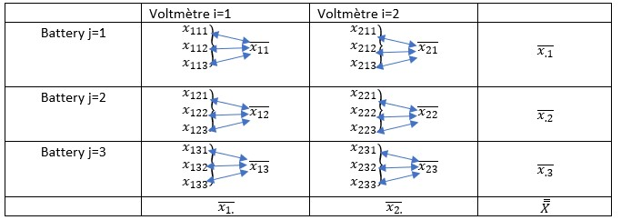
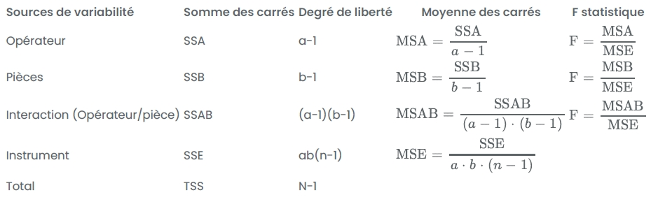
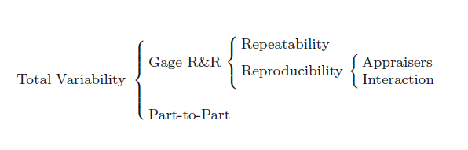

# ANOVA à deux facteurs

```{r setup, include=FALSE}
knitr::opts_chunk$set(echo = TRUE)
```

## Mesure du voltage de batteries

Nous avons $a=2$ appareils de mesure, $i=1,2$ (voltmètres, facteur A, « *appraisers* » en anglais), et $b=3$ batteries, $j=1,2,3$ (facteur B, « *parts* » en anglais).

Chaque batterie est mesurée $R=3$ fois avec chaque voltmètre, soit $a\times b\times R=18$ mesures.

```{r}
a<-2
b<-3
R<-3
```

Voici nos données :

```{r}
voltmeter<-rep(1:2,each=9)
battery<-rep(rep(1:3,each=3),2)
run<-rep(1:3,6)
voltage<-c(1.4727,1.4206,1.4754,1.5083,1.5739,
           1.4341,1.5517,1.5483,1.4614,1.3337,
           1.6078,1.4767,1.4066,1.5951,1.8419,
           1.7087,1.8259,1.5444)
batteries<-data.frame(voltmeter,battery,run,voltage)
batteries
```

En toute rigueur, nous devrions vérifier que :

-   chaque échantillon est issu d'une population normale

-   les variances conditionnelles (variances dans chaque sous-population) sont identiques : **homoscédasticité**

-   les sous-échantillons sont indépendants

Néanmoins, en pratique, l'ANOVA est assez robuste à ces écarts.

```{r warning=FALSE, include=FALSE}
library(dplyr)
library(magrittr)
 batteries <- batteries %>% mutate(voltmeter=as.factor(voltmeter)) %>% mutate(battery=as.factor(battery))  %>% mutate(run=as.factor(run))
batteries
```

```{r eval=FALSE, include=FALSE}
library(ggplot2)
ggplot(batteries, aes(x =battery, y = voltage)) + 
  ggdist::stat_halfeye(
    adjust = .5, 
    width = .6, 
    .width = 0, 
    justification = -.3, 
    point_colour = NA) + 
  geom_boxplot(
    width = .25, 
    outlier.shape = NA
  ) +
  geom_point(
    size = 1.3,
    alpha = .3,
    position = position_jitter(
      seed = 1, width = .1
    )
  ) + 
  coord_cartesian(xlim = c(1.2, NA), clip = "off")->gr
gr
```

```{r eval=FALSE, include=FALSE}
library(DT)
str(batteries)
datatable(batteries, class = 'cell-border stripe')
```

Soit $x_{ijr}$ l'observation numéro $r$ dans l'échantillon $E_{ij}$ où $(i,j)\in \left \{ 1,2 \right \} \times \left \{ 1,2,3 \right \}$.



On a :

$\overline{x}_{ij}=\frac{1}{3}\sum_{r=1}^{3}x_{ijr}$

Que nous pouvons obtenir par :

```{r}
with(batteries, tapply(voltage, list(voltmeter, battery), mean))->mat_Xbar_ij
rownames(mat_Xbar_ij)<-c("vol1","vol2")
colnames(mat_Xbar_ij)<-c("bat1","bat2","bat3")
mat_Xbar_ij
```

Les moyennes marginales sont :

$\overline{x}_{i.}=\frac{1}{3}\sum_{j=1}^{3} \overline{x}_{ij}$

$\overline{x}_{.j}=\frac{1}{2}\sum_{i=1}^{2} \overline{x}_{ij}$

Que nous obtenons avec les commandes :

```{r}
(xbar_i.<-apply(mat_Xbar_ij,1,mean))
```

```{r}
(xbar_.j<-apply(mat_Xbar_ij,2,mean))
```

et la moyenne générale $\overline{\overline{X}}$ :

```{r}
(xbarbar<-mean(batteries$voltage))
```

### Hypothèses

Trois tests sont réalisés : l'effet du facteur A (voltmètre), l'effet du facteur B (batterie) et l'effet de l'interaction A×B.

$H_{0}^{A} : \mu_{i.}=\mu ,\; \forall \; i$

$H_{0}^{B} : \mu_{.j}=\mu , \; \forall \; j$

$H_{0}^{AB} : \mu_{ij}-\mu_{i.}-\mu_{.j}+\mu=0 ,\; \forall \; i,j$ (pas d'interaction)

Décomposition de l'écart à la moyenne générale :

$x_{ijr}-\overline {\overline{X}}=(\overline{x}_{i.}-\overline {\overline{X}})+(\overline{x}_{.j}-\overline {\overline{X}})+(\overline{x}_{ij}-\overline{x}_{i.}-\overline{x}_{.j}+\overline {\overline{X}})+(x_{ijr}-\overline{x}_{ij})$

D'où (les doubles produits s'annulent) :

$$
\begin{matrix}SCT & = &SCE_{A}  & + & SCE_{B} & + & SCE_{AB} & + &SCR \\  \sum_{i=1}^{a}\sum_{j=1}^{b}\sum_{r=1}^{R}\left ( x_{ijr}-\overline {\overline{X}} \right )^{2}& = & \sum_{i=1}^{a}(\overline{x}_{i.}-\overline {\overline{X}})^{2}\times b\times R & + & \sum_{j=1}^{b}(\overline{x}_{.j}-\overline {\overline{X}})^{2}\times a\times R & + & SCE_{AB} & + & \sum_{i=1}^{a}\sum_{j=1}^{b}\sum_{r=1}^{R}(x_{ijr}-\overline{x}_{ij})^{2}\end{matrix}
$$

avec $SCE_{AB}=R\sum_{i=1}^{a}\sum_{j=1}^{b}(\overline{x}_{ij}-\overline{x}_{i.}-\overline{x}_{.j}+\overline{\overline{X}})^{2}$.

Calculons ces termes :

```{r}
(SCT<-sum((batteries$voltage-xbarbar)^2))
```

```{r}
(SCE_A<-sum((xbar_i.-xbarbar)^2)*b*R)
```

```{r}
(SCE_B<-sum((xbar_.j-xbarbar)^2)*a*R)
```

```{r}
temp<-NULL
for (i in 1:2) {
    for (j in 1:3){ 
      temp<-c(temp,(mat_Xbar_ij[i,j]-xbar_i.[i]-xbar_.j[j]+xbarbar)^2)
                  }
                }
(SCE_AB<-sum(temp)*3)
```

```{r}
temp<-NULL
for (i in 1:2) {
    for (j in 1:3){ 
      for (k in 1:3){
      temp<-c(temp,(batteries[batteries$voltmeter==i & batteries$battery==j & batteries$run==k,]$voltage-mat_Xbar_ij[i,j])^2)
      
          }
      }
}

(SCR<-sum(temp))

```

Le tableau ci-dessous résume ces résultats : pour obtenir les moyennes des carrés, il suffit de diviser les sommes des carrés par leurs degrés de liberté :




(nous pouvons utiliser des acronymes anglais ou français : SSE et SCR sont identiques, de même que MSE et MCR)


Tout ceci est assez fastidieux. Heureusement, avec *R*, tous ces termes se retrouvent très facilement :

### ANOVA avec R

```{r}
result<-anova(lm(voltage~battery+voltmeter+battery*voltmeter,
                 data = batteries))
result
```

Remarque : les valeurs de $F$ et de $p$ de `anova()` supposent un modèle à effets fixes (chaque effet est testé par rapport au carré moyen résiduel). Dans une étude R&R, les facteurs sont aléatoires : l'interaction se teste avec $MSAB/MSE$, et, tant que l'interaction est conservée dans le modèle, les facteurs A et B avec $MSA/MSAB$ et $MSB/MSAB$ (voir plus bas le tableau du package SixSigma : $F_A=4.812$ et $F_B=3.415$).

Décomposition de la variabilité :



La répétabilité, $\sigma^{2}_{repeatability}=\frac{SCR}{ab(R-1)}$ est obtenue directement comme le « Residuals Mean Sq » de la 4e ligne :

```{r}
result$`Mean Sq`[4]
```

La variabilité due au voltmètre (ou Appraiser) $\sigma^{2}_{Appraisers}=\frac{MSA-MSAB}{b\times R}$ est :

```{r}
(result$`Mean Sq`[2]-result$`Mean Sq`[3])/(b*R)
```

La variabilité due à l'interaction Batterie-Voltmètre, $\sigma^{2}_{Interaction}=\frac{MSAB-MSE}{R}=\frac{MSAB-\sigma^{2}_{repeatability}}{R}$ est :

```{r}
(result$`Mean Sq`[3]-result$`Mean Sq`[4])/R
```

(cette valeur étant négative, nous prendrons zéro)

La reproductibilité, $\sigma^{2}_{reproducibility}=\sigma^{2}_{Appraisers}+\sigma^{2}_{Interaction}$ est alors :

```{r}
max(0, (result$`Mean Sq`[2]-result$`Mean Sq`[3])/(b*R)) + max(0, (result$`Mean Sq`[3]-result$`Mean Sq`[4])/R)
```

Le Gage R&R mesure la variabilité provoquée par le système de mesure, que nous comparerons ensuite à la variabilité totale.

$\sigma^{2}_{R\&R}=\sigma^{2}_{repeatability}+\sigma^{2}_{reproducibility}$, prend la valeur :

```{r}
result$`Mean Sq`[4]+(result$`Mean Sq`[2]-result$`Mean Sq`[3])/(b*R)
```

La variation due au processus, $\sigma^{2}_{Part \; to \;Part}=\frac{MSB-MSAB}{a\times R}$ :

```{r}
(result$`Mean Sq`[1]-result$`Mean Sq`[3])/(a*R)
```

Enfin, la variabilité totale $\sigma^{2}_{Totale}=\sigma^{2}_{R\&R}+\sigma^{2}_{Part \; to \;Part}$ :

```{r}
result$`Mean Sq`[4]+(result$`Mean Sq`[2]-result$`Mean Sq`[3])/(b*R)+(result$`Mean Sq`[1]-result$`Mean Sq`[3])/(a*R)
```

Pour qu'un système de mesure soit acceptable, le rapport entre l'écart type du Gage R&R et l'écart type total ne doit pas dépasser 10 %.

$\%Gage \;R\&R=\frac{\sigma_{R\&R}}{\sigma_{Totale}}<10\%$

Une valeur comprise entre 10 et 30 % peut être acceptable.

Une valeur supérieure à 30 % représente un mauvais système de mesure.

Dans notre exemple, nous avons :

```{r}
sqrt(result$`Mean Sq`[4]+(result$`Mean Sq`[2]-result$`Mean Sq`[3])/(b*R))/sqrt(result$`Mean Sq`[4]+(result$`Mean Sq`[2]-result$`Mean Sq`[3])/(b*R)+(result$`Mean Sq`[1]-result$`Mean Sq`[3])/(a*R))
```

Ce rapport (91.7 %) signifie que la plus grande partie de la variation observée est due à la variabilité du système de mesure et non aux différences entre batteries.

### Utilisation du Package SixSigma de R

```{r echo=TRUE, message=TRUE, warning=FALSE}
library(SixSigma)
gage_rr<-ss.rr(var = voltage,part = battery,appr = voltmeter,data = batteries,main = "Six Sigma Gage R&R Measure",sub = "Batteries Projet MSA")
```

```{r}
gage_rr
```

Le package retient ici le modèle réduit : l'interaction n'est pas significative ($p=0.573>0.05$), elle est donc regroupée avec la répétabilité. Le Gage R&R représente alors 93.13 % de la variation totale (%StudyVar), contre 91.7 % dans notre calcul où l'interaction est seulement ramenée à zéro. Le nombre de catégories distinctes est 1.

## 7 opérateurs

Sept opérateurs ont chacun mesuré 10 pièces, 2 fois chacune, soit 140 mesures.

```{r}
dd<-read.csv("https://sjaubert.github.io/SPCR/Bachelor_RR.csv",header = T,dec = ".",sep = ";")
```

Représentation visuelle des données par opérateurs :

```{r}
library(ggplot2)
ggplot(dd, aes(y=mesure, x=operateur,colour=operateur ,fill=operateur))+
geom_boxplot(alpha=0.5, outlier.alpha=0)+
geom_jitter(width=0.2)+
theme_classic()+geom_violin()
```

```{r}
library(SixSigma)
gage_rr<-ss.rr(var = mesure,part = part,appr = operateur,data = dd,main = "Six Sigma Gage R&R Measure",sub = "diamètre de niveau à bulle")
```

------------------------------------------------------------------------

*Document créé le 17 juin 2021. Révisions : 23 juin 2021, 25 juin 2021, 26 juin 2021, 23 novembre 2026.*
